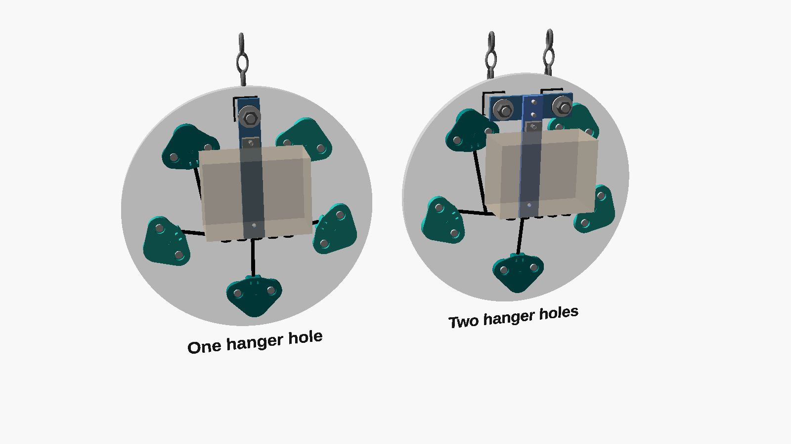
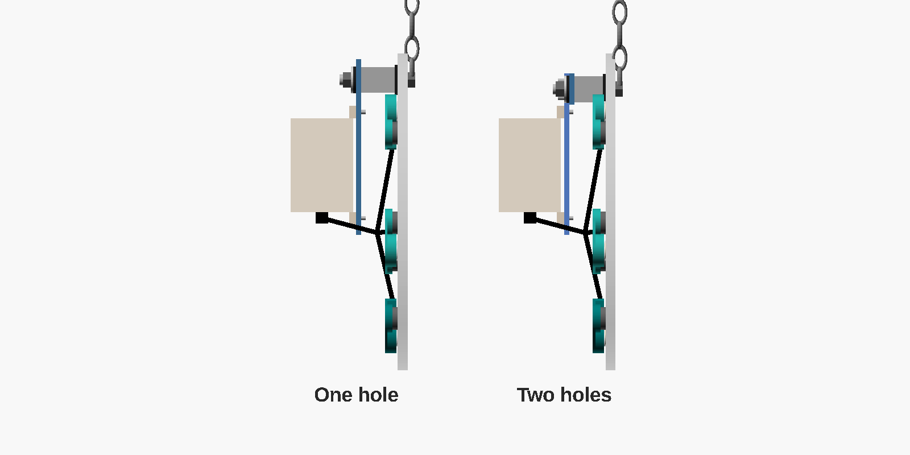
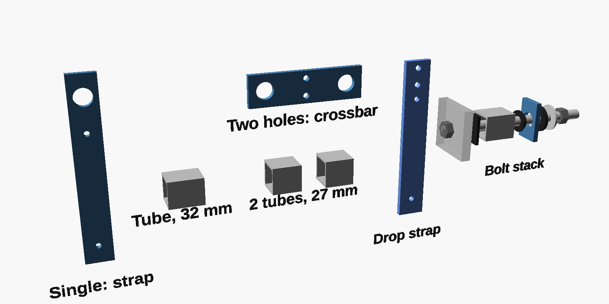

# OpenGong box brackets (example sketches)

Two example brackets for hanging the electronics box from the plate's own hanger bolts, as described in [Step 10, section 10.3](https://github.com/somekid6/OpenGong/wiki/Step-10-Enclosure-and-Mounting#103-hang-the-box). Nothing needs bending. A short length of square tube on each hanger bolt spaces the bracket off the steel, and the rest is straight flat bar, so you only need a saw and a drill.

These are sketches to adapt, not drawings for one plate. Hanger hole positions vary a lot between plates, so measure yours and set the values in [opengong_bracket.scad](opengong_bracket.scad). The pods in the preview come from the [cover model](../Sensor%20Cover/opengong_cover.scad), so you can check that the bracket clears them.

## The two brackets

| Plate | Bracket | Cut list (defaults) |
| --- | --- | --- |
| One hanger hole | **Tube + strap.** The hanger bolt clamps a square tube spacer against the steel and a straight strap against the tube. The box hangs from the strap. | 25 mm square tube, 32 mm long. 25 × 5 mm flat bar, 169 mm long. |
| Two hanger holes | **Tubes + crossbar + drop strap.** Each hanger bolt clamps its own tube. A crossbar spans both tubes, and a drop strap bolts to the crossbar's centre with two M5 bolts and carries the box. | Two 25 mm square tubes, 27 mm long. 30 × 5 mm flat bar, 106 mm long. 25 × 5 mm flat bar, 155 mm long. |

Flat bar can be aluminium (25 × 5 mm) or steel (25 × 3 mm is enough). Tube wall about 2 mm; the bolt passes through the bore without touching it.

Both brackets:

- **Hold the box 40 mm off the back face** (`box_off`). The tube length sets this: the model works out the length from `box_off` and prints it. Cut the tube ends square so the bar sits flat.
- **Leave the space above each bolt free**, so the chain can't bear on the bracket.
- **Stay inside the plate outline** and clear of the pods.
- **Hang the box by its top and bottom mounting lugs**, two M4 screws through the strap. If your box has corner ears instead, bolt a small adapter plate across the strap.

The single-hole strap hangs from one bolt, so it can turn about it. Tighten the nut until the rubber pad grips, and check after the first session that the box is still square. The two-hole bracket can't turn.

## Bolt stack

From the back face outward: rubber pad (3 mm), square tube, the flat bar with a rubber top-hat bushing in its oversize hole, a rubber washer, a steel fender washer, and a nyloc nut. The bushing keeps the bolt off the bar, so no metal touches metal at the bracket.

The hanger bolt has to pass through the tube, so it's longer than the one the plate came with: at least 66 mm under the head for the single-hole bracket and 61 mm for the two-hole one at the defaults. The console prints the length for your settings.

## Parameters

Open the file in OpenSCAD, set `part` to `assembly`, `side`, `single`, `dual` or `details`, and press **F5**. The console prints the cut lengths and bolt length, and a `WARNING` if the box leaves the plate outline or a part runs into another.

| Parameter | Default | Set it to |
| --- | --- | --- |
| `single_hole_y` | 127 | Height of your single hole's centre above the plate centre |
| `dual_hole_y`, `dual_spacing` | 118, 76 | Height of your two holes above the plate centre, and their centre-to-centre spacing |
| `hanger_d` | 10 | Your hanger bolt diameter |
| `tube`, `tube_wall` | 25, 2 | Your square tube's outside size and wall |
| `bar_w`, `cross_w`, `bar_t` | 25, 30, 5 | Your flat bar: strap width, crossbar width, thickness |
| `strap_above`, `cross_out` | 20, 15 | How far the strap runs above the bolt; how far the crossbar runs past each bolt |
| `box`, `lug` | 120 × 90 × 60, 20 × 12 × 3 | Your box body and its mounting lugs |
| `box_off`, `box_y0` | 40, 0 | Box distance off the steel, and the height of its bottom above the plate centre |
| `plate_d`, `plate_t` | 304.8, 9.5 | Your plate |
