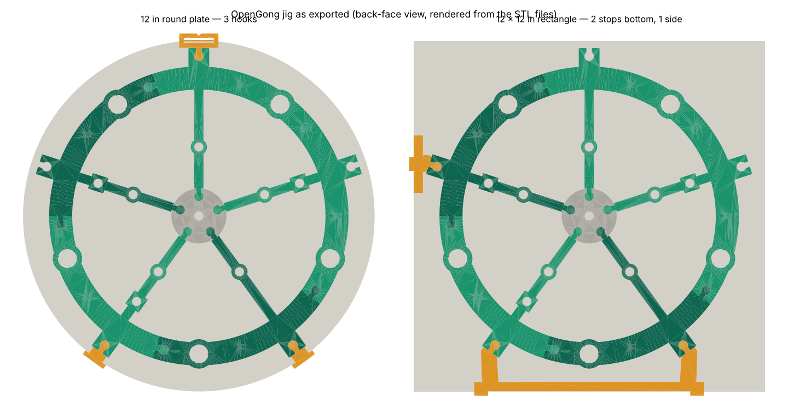
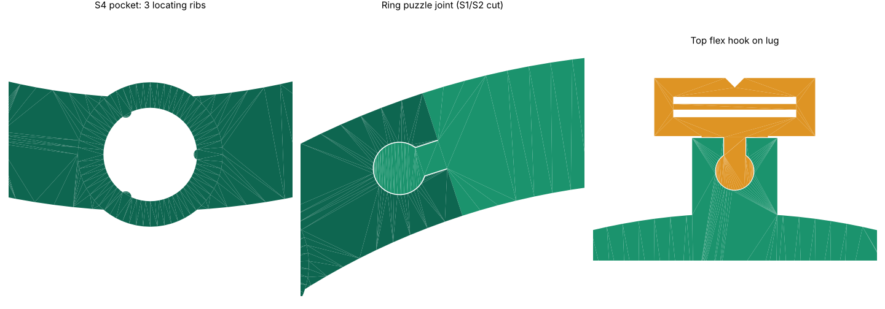

# OpenGong placement jig

The jig is a 3D-printed ring that sets the position of every piezo sensor and every calibration punch point on the back of the plate. One **core ring** carries the five sensor pockets and the punch guides. A swappable **adapter** locates that ring on either a rectangular plate or a round plate, so both plate shapes share the same ring and the same coordinates. The model is a single parametric OpenSCAD file, [opengong_jig.scad](opengong_jig.scad). The design reasoning is in [System Design §4.1](../docs/System-Design.md#41-placement-jig-petg-model-opengong_jigscad).





## Parts

| `part` value | Qty | What it is | Needed for |
| --- | --- | --- | --- |
| `segment` (`segment_index` 0–4) | 5 | Ring segments S1–S5. Each holds one sensor pocket, one spoke and one lug. S1 has the "up" arrow. | Every plate |
| `hub` | 1 | Centre hub, carrying punch guide P0 | Every plate |
| `rect_bottom` | 1 | Bottom bar with **2 edge stops**. It plugs into the two lower lugs. | Rectangular plate |
| `rect_side` | 1 | Side bar with **1 edge stop**. It plugs into one side lug. | Rectangular plate |
| `round_top_flex` | 1 | Springy top hook with the sight groove and V-notch | Round plate |
| `round_left`, `round_right` | 1 each | Fixed lower hooks | Round plate |
| `test_bar` | 1 | 200 mm bar for measuring shrinkage | Print it first |
| `assembly` | — | Preview only (`preview_plate` = `round` or `rect`). Don't print it. | — |

A rectangular plate needs 8 printed parts: 5 segments, the hub and the 2 rectangle adapters. A round plate needs 9: 5 segments, the hub and the 3 hooks.

**Bed size.** Each ring segment fits within about 129 × 129 mm. The `rect_bottom` bar is about 200 mm long, so it needs a 220 mm-class bed. Every other part is smaller.

## 1. Set the parameters for your parts and plate

Open the file in OpenSCAD and use **Window → Customizer**, or edit the values at the top of the file. Check these before you print:

| Parameter | Default | Set it to |
| --- | --- | --- |
| `disc_d` | 15 | The diameter of **your** piezo discs, measured with calipers (12–15 mm discs per the design) |
| `guide_d` | 8 | The nose diameter of **your** automatic center punch. The bore is printed at exactly this size, so add about 0.2 mm if your printer prints holes tight. |
| `rect_center_from_bottom` | 152.4 | Rectangular plate: distance from the ring centre to the bottom edge. The default centres the ring on a 12 × 12 in plate. |
| `rect_center_from_side` | 152.4 | Rectangular plate: distance from the ring centre to the edge that gets the side stop |
| `rect_side` | −1 | Which edge gets the side stop. −1 is the left edge seen from the back, which is the right edge seen from the shooter. +1 is the other edge. |
| `plate_d` | 304.8 | Round plate: its actual diameter |

After changing anything, press **F5** and read the console. The model echoes three kinds of line:

- **`SENSOR S1 … S5`**: sensor positions in front-view coordinates, ready for the firmware.
- **`PUNCH fit P0 … P5`** and **`PUNCH holdout H1, H2, H4`**: the punch-guide positions, in the same coordinates.
- **`WARNING …`**: the parts won't fit your plate. Don't print until all warnings are gone.

| Warning | Cause | Limit with the default 120 mm ring |
| --- | --- | --- |
| `plate_d too small for ring_r` | The round hooks would collide with the lugs | `plate_d` ≥ about 304.3 mm. A 12 in plate fits with 0.5 mm to spare. |
| `bottom bar hits the S4 pocket boss` | The ring centre is too close to the bottom edge | `rect_center_from_bottom` ≥ about 141.8 mm |
| `side bar hits the side lug` | The ring centre is too close to the side edge | `rect_center_from_side` ≥ about 150.6 mm. The default 152.4 leaves about 1.8 mm. |

On a smaller plate, reduce `ring_r`, then read [Changing the ring size](#changing-the-ring-size).

## 2. Export the STL files

To export from the OpenSCAD GUI, set `part` (and `segment_index` for the segments) in the Customizer. Then render with **F6** and export with **F7**. Repeat for each part you need.

From the command line (bash shown):

```
S=opengong_jig.scad
for i in 0 1 2 3 4; do openscad -o S$((i+1)).stl -D 'part="segment"' -D segment_index=$i $S; done
openscad -o hub.stl      -D 'part="hub"'            $S
openscad -o test_bar.stl -D 'part="test_bar"'       $S
# rectangular plate
openscad -o rect_bottom.stl -D 'part="rect_bottom"' $S
openscad -o rect_side.stl   -D 'part="rect_side"'   $S
# round plate
openscad -o round_top_flex.stl -D 'part="round_top_flex"' $S
openscad -o round_left.stl     -D 'part="round_left"'     $S
openscad -o round_right.stl    -D 'part="round_right"'    $S
```

Add `-D` overrides for any parameters you changed, such as `-D disc_d=12.7`, or save them as a Customizer preset.

## 3. Print

1. **Test bar first.** Print `test_bar` in the same material and with the same settings you'll use for the jig. Measure its length with calipers. Then set the XY scale of every jig part in your slicer to 200 ÷ measured length. For example, a bar measuring 199.4 mm needs a scale of 100.3%. The two 3 mm holes are 190 mm apart, centre to centre, if you'd rather measure those.
2. **Material.** PETG is recommended. It stays springy and tough, so the round-plate flex hook keeps its preload, the puzzle joints flex as they press together, and the punch guides don't crack. It also holds its shape up to about 75 °C, which matters on a plate left in the sun.
   - **PLA:** fine for a rectangular plate if the jig is kept out of heat, since PLA softens at about 55–60 °C. For a round plate, print `round_top_flex` in PETG: a PLA beam is brittle and slowly loses its spring under load. Print a test bar in each material and scale each part from its own bar.
   - **ABS/ASA:** fine. These shrink and warp more, but the test-bar scaling makes up for the shrinkage.
   - **Avoid** TPU or other flexible filaments, which are too soft to hold positions, and silk PLA, which is weak between layers.
3. **Orientation.** Print the segments and the hub as exported: flat face down, bosses up. The adapters are exported already flipped, with the plate-side face up, so they print without supports. No part needs supports.
4. **Puzzle joints.** The joints are full-height and print flat. If the knobs won't go in, check the slicer's XY scale and elephant-foot compensation before changing `fit`, the per-side joint clearance (0.15 mm by default).

## 4. Assemble

1. Lay the five segments flat on a table or glass sheet, S1 to S5 in order, with S1's "up" arrow pointing up.
2. Press each ring joint together. Each segment carries a knob at one end and a socket at the other.
3. Press the hub into the five spoke knobs.
4. Press the adapter pieces into their lugs: the knob on each adapter goes into the socket on the lug.
   - **Rectangular plate:** the bottom bar goes on the two lower lugs, and the side piece on the side lug that `rect_side` chose.
   - **Round plate:** the flex hook goes on the top lug, and the fixed hooks on the two lower lugs.
5. The joints lock in-plane on their own. A drop of CA in each joint is optional and makes the ring stiffer, but it can no longer be taken apart.

## 5. Seat the jig on the plate

Sand the sensor spots on the back face to bright metal first, then wipe them with isopropyl alcohol to remove dust and finger oil ([System Design §4](../docs/System-Design.md#4-sensors-harness-and-mechanical)). Glue the same day you sand. Then put the jig flat on the back face with the up arrow pointing to the top of the plate as it hangs.

**Rectangular plate.** Push the jig down and into the corner until all three stops touch the plate edges: two on the bottom edge and one on the side.

**Round plate.**
1. Hook the two fixed hooks over the rim at the bottom.
2. Snap the flex hook over the top of the rim. Its thin beam is designed to press against the rim, which pushes the plate onto the two fixed hooks and centres the ring. This works even if the plate's diameter is off by about ±1 mm.
3. A round plate has no edge to set rotation, so turn the jig until the sight groove and V-notch on the top hook line up with the centre of the hanger hole, or with a paint mark on the rim. A 1 mm misalignment at the rim rotates every coordinate by about 0.4°, which is under 0.7 mm of error at 100 mm from centre.

## 6. Glue the sensors

Put the glue on the plate **before** the disc goes in. Once a disc is in its pocket there is only about 0.15 mm of clearance around it, so glue can't be worked underneath afterwards.

Prep the discs first. Lightly scuff each disc's brass face with 400–600 grit until it is dull, then wipe it with isopropyl alcohol. Don't sand the ceramic side, and from then on handle the disc only by its edge or ceramic side ([System Design §4](../docs/System-Design.md#4-sensors-harness-and-mechanical)).

1. With the jig seated, put a **small** dot of CA or hard-setting epoxy on the bare metal at the centre of the pocket. Reach in through the bore with a toothpick or needle.
2. Drop the piezo disc into its pocket, brass side down. Three ribs centre it.
3. Press on the disc through the 10 mm boss so the glue spreads into a thin, rigid layer ([System Design §4](../docs/System-Design.md#4-sensors-harness-and-mechanical)).
4. Keep the dot small. A 0.8 mm chamfer at the bottom of each pocket catches a little squeeze-out so it can't lock the jig to the plate, but too much glue can reach the ribs or the jig's underside.
5. CA can set before all five discs are pressed. Glue one pocket at a time, or use a slower epoxy (e.g. JB Weld) for more working time.
6. Let the glue cure, then lift the jig straight off over the sensor leads. Solder the leads afterwards, or keep them clear of the boss while lifting.

Keep the jig: it goes back on for calibration.

## 7. Calibration points

Re-seat the jig exactly as in step 5 and fire an automatic center punch through each guide, 3–5 times per guide. Round bosses are the fitting points, and square bosses are the held-out checks. The punch strikes the back face, the same face as the sensors; the firmware's `cal start` assumes this by default.

Coordinates for the default model are in mm, front view, with the origin at the ring centre and +y up:

| Point | x | y | Use |
| --- | --- | --- | --- |
| P0 | 0.00 | 0.00 | Fit (hub) |
| P1 | 0.00 | 60.00 | Fit |
| P2 | 57.06 | 18.54 | Fit |
| P3 | 35.27 | −48.54 | Fit |
| P4 | −35.27 | −48.54 | Fit |
| P5 | −57.06 | 18.54 | Fit |
| H1 | 87.50 | 28.43 | Held-out check |
| H2 | 54.08 | −74.43 | Held-out check |
| H4 | −87.50 | 28.43 | Held-out check |

| Sensor | x | y |
| --- | --- | --- |
| S1 | −70.53 | 97.08 |
| S2 | 70.53 | 97.08 |
| S3 | 114.13 | −37.08 |
| S4 | 0.00 | −120.00 |
| S5 | −114.13 | −37.08 |

These are the firmware defaults. The firmware also accepts the point names directly, as in `cal at P2` and `check H1`. The full procedure is in the [firmware README](../firmware/README.md#calibration).

## Coordinate frame

- **Origin:** the ring centre, not a plate corner, so the coordinates don't depend on plate shape or size.
- **Axes:** +y is up as the plate hangs. The model is drawn as seen from the **back** face, because that is where the jig sits.
- **Front view:** the solver works in front-view coordinates, as the shooter sees the plate: **x_front = −x_model**, with y unchanged. The console output is already converted to front view.

## Changing the ring size

`ring_r` (default 120 mm) sets the sensor circle. If you change it, or change `fit_r` (60) or `holdout_r` (92):

- Copy the new `SENSOR` lines from the console into the firmware with `set s <ch> <x> <y>`, then `save`.
- The firmware's built-in names P0–P5 and H1/H2/H4 only match the default positions. Use numeric coordinates from the new `PUNCH` lines instead, for example `cal at 0 70`.
- A larger ring covers a larger scoring zone but needs a larger plate; check the console warnings. A rectangle-only build can use `ring_r = 140`, which is the layout in the accuracy table in [System Design §2](../docs/System-Design.md#2-accuracy-budget). That ring won't fit a 12 in round plate.

## Parameter reference

| Group | Parameter (default) | Meaning |
| --- | --- | --- |
| Piezo discs | `disc_d` (15), `disc_clear` (0.15) | Piezo disc diameter; radial clearance between the disc and the ribs |
| | `bump_h` (0.6), `bump_d` (2) | How far the 3 locating ribs stand proud of the bore; rib diameter |
| | `boss_wall` (4.5), `boss_h` (10) | Pocket boss wall thickness and height |
| | `glue_chamfer` (0.8) | Squeeze-out relief at the plate face |
| Ring | `ring_r` (120) | Sensor circle radius |
| | `ring_w` (20), `jig_t` (6) | Ring band width; jig thickness |
| | `spoke_w` (8), `hub_r` (24) | Spoke width; hub radius |
| | `lug_len` (16), `lug_w` (18) | Adapter lug size |
| Punch guides | `guide_d` (8) | Bore diameter, matching your punch nose |
| | `guide_wall` (3), `guide_h` (12) | Guide boss wall thickness and height |
| | `fit_r` (60) | Radius of P1–P5 |
| | `holdout_r` (92), `holdout_spokes` ([1, 2, 4]) | Radius and spokes of the held-out points |
| Joints | `fit` (0.15) | Per-side puzzle-joint clearance |
| | `knob_d` (8), `neck_w` (4.5), `knob_off` (7) | Puzzle knob geometry |
| Rectangular plate | `rect_center_from_bottom`, `rect_center_from_side` (152.4) | Ring centre position on the plate |
| | `rect_side` (−1) | Which edge gets the side stop |
| | `bar_w` (8), `stop_t` (4), `stop_w` (12) | Adapter bar width; stop thickness and width |
| | `lip` (3) | How far the stops and hooks hang over the plate edge |
| | `rect_plate_w`, `rect_plate_h` (304.8) | Preview only |
| Round plate | `plate_d` (304.8) | Plate diameter |
| | `hook_w` (22), `hook_wall` (4), `rim_clear` (0.1) | Fixed hook width, wall thickness and rim clearance |
| | `flex_len` (26), `flex_t` (1.2), `flex_gap` (1.5) | Flex beam length, thickness and the gap behind it |
| | `flex_preload` (0.4) | How far the flex beam presses into the rim |
| | `plate_t` (9.5) | Preview only |
| Test bar | `test_len` (200) | Test bar length |
