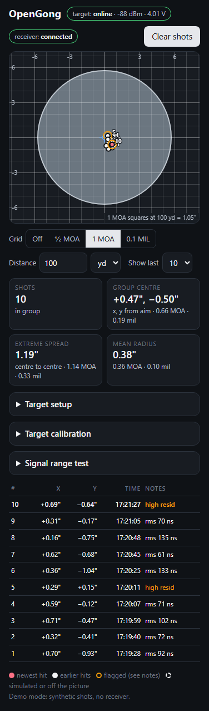

# OpenGong — Multilateration Electronic Target

> [!WARNING]
> **Work in progress.** OpenGong is incomplete and not yet fully built or tested. Designs, firmware and documentation may change, and parts of the system may not work as described. Build at your own risk.

Five piezo sensors bonded to the back of an AR500 steel plate locate bullet impacts to within about 5 mm by time-difference-of-arrival multilateration. An ESP32-S3 (Heltec WiFi LoRa 32 V3) timestamps each sensor in hardware, solves the impact position, and sends the coordinates over LoRa to a receiver at the firing line. The link is designed for 500 m, and about 1 km is a realistic planning figure on open ground. The estimated limit is 2–4 km on flat, open ground with clear line of sight. These are link-budget estimates, so run a [signal range test](docs/System-Design.md#96-signal-range-test) at your own site. It works with any single-projectile round the plate is rated for, from .22 LR to full-power rifle; shotgun pellets are not supported.

## Documents

- [System design](docs/System-Design.md): architecture, accuracy budget, sensors, mounting and enclosure, solver, calibration, radio link and range, ammunition and safety, bill of materials and build plan.
- [Wiring diagram](docs/Wiring-Diagram.md): system wiring, per-channel circuit, shared bias/threshold/power, Heltec pin map and channel-to-part map.
- [Analog board PCB](hardware/analog-board/README.md): ready-to-order gerbers, BOM, assembly and bring-up for the 5-channel front end that the Heltec V3 plugs into, plus the KiCad project.
- [Placement jig](Placement%20Jig/README.md): the OpenSCAD sensor and punch-guide jig for rectangular and round plates, covering parameters, export, printing, assembly and calibration points.
- [Sensor covers](Sensor%20Cover/README.md): OpenSCAD cover pods and cable clips held on by rubber-coated pot magnets, with the magnet and hardware list, printing, fitting and removal for calibration.
- [Firmware](firmware/README.md): ESP32-S3 target (hardware capture, solver, on-board calibration, LoRa) and receiver firmware, with build, bring-up and calibration steps. The receiver hosts a [web app](firmware/README.md#web-app) over its own Wi-Fi that draws your plate to scale with the hits and an MOA/MIL grid on any phone or laptop.

The receiver's web app on a phone and a laptop: the plate to scale, numbered hits, an MOA or mil grid and the group statistics. It can also walk you through calibrating the target from your phone ([firmware README](firmware/README.md#web-app)).

Web app screenshots

## Safety

Follow your plate maker's rating for the round you shoot. [System design §10](docs/System-Design.md#10-ammunition-and-safety-read-before-shooting) lists commonly cited plate thicknesses and minimum distances per caliber. Never use steel-core or penetrator rounds. Keep all electronics and cables fully behind the plate under a steel shield.

## References and acknowledgements

OpenGong builds on the work of **Matthew Waterman and Donato Salazar**, whose Northern Illinois University senior design project showed that an accurate electronic target can be built from cheap, easy-to-find parts. Thank you both for publishing your research and source code so others could build on it.

- M. Waterman and D. Salazar, "Electronic Target," Senior Design II, Northern Illinois University (advisor: Dr. Abul Azad), December 8, 2011. [Paper (PDF)](docs/Reference%20Materials/Waterman%20Salazar%20-%20Electronic%20Targets.pdf) · [Presentation with notes (PDF)](docs/Reference%20Materials/Waterman%20Salazar%20Tech%20478%20Presentation%20With%20Notes.pdf). These were first published on etarg.net, which is no longer online, so copies are kept here.

Their paper sets out the core approach this project uses: timing the impact wave at piezo sensors on a hard target with threshold comparators, then locating the hit by time-difference-of-arrival multilateration. It also names the error sources this design sets out to remove. [System design §1](docs/System-Design.md#1-summary) compares the two.

AI assistance: [Claude](https://www.anthropic.com/claude), by Anthropic, helped with the design analysis, firmware, documentation and diagrams. This project wouldn't have been possible with my personal time constraints and skill level.
