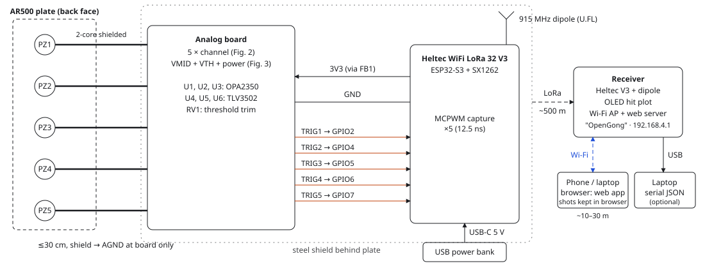

# OpenGong — Multilateration Electronic Target

Five piezo sensors bonded to the back of an AR500 steel plate locate bullet impacts to within about 5 mm by time-difference-of-arrival multilateration. An ESP32-S3 (Heltec WiFi LoRa 32 V3) timestamps each sensor in hardware, solves the impact position, and sends the coordinates over LoRa to a receiver at the firing line. The link is designed for 500 m, and about 1 km is a realistic planning figure on open ground. The estimated limit is 2–4 km on flat, open ground with clear line of sight. These are link-budget estimates, so [range-test](docs/System-Design.md#96-range-test) your own site. It works with any single-projectile round the plate is rated for, from .22 LR to full-power rifle; shotgun pellets are not supported.

## Documents

- [System design](docs/System-Design.md): architecture, accuracy budget, sensors, solver, calibration, radio link and range, ammunition and safety, bill of materials and build plan.
- [Wiring diagram](docs/Wiring-Diagram.md): system wiring, per-channel circuit, shared bias/threshold/power, Heltec pin map and channel-to-part map.
- [Placement jig](Placement%20Jig/README.md): the OpenSCAD sensor and punch-guide jig for rectangular and round plates, covering parameters, export, printing, assembly and calibration points.
- [Firmware](firmware/README.md): ESP32-S3 target (hardware capture, solver, on-board calibration, LoRa) and receiver firmware, with build, bring-up and calibration steps.

## Safety

Follow your plate maker's rating for the round you shoot. [System design §10](docs/System-Design.md#10-ammunition-and-safety-read-before-shooting) lists commonly cited plate thicknesses and minimum distances per caliber. Never use steel-core or penetrator rounds. Keep all electronics and cables fully behind the plate under a steel shield.
