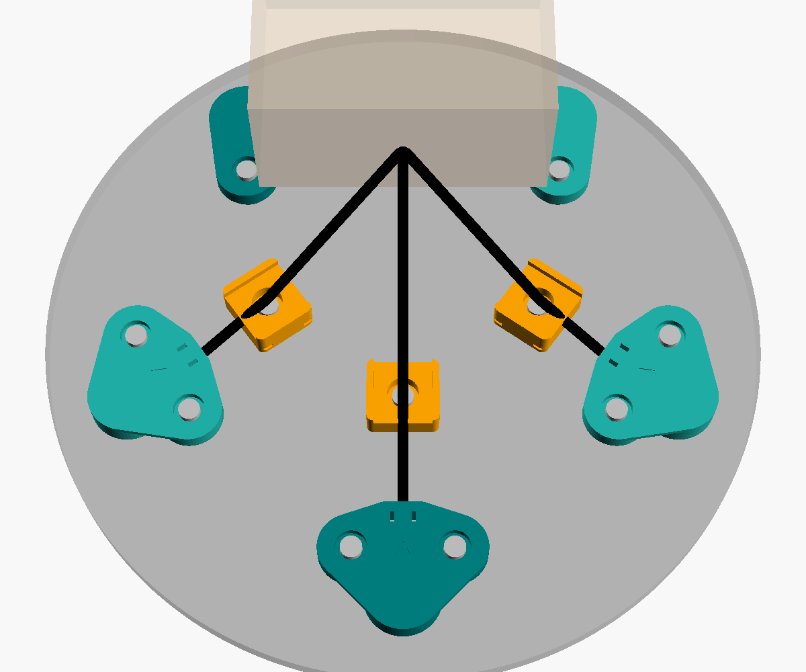
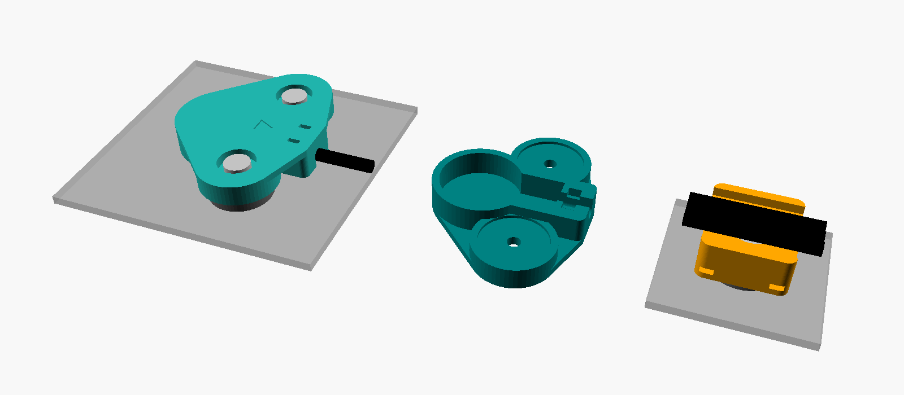

# OpenGong sensor covers

The sensor covers protect the five piezo sensors on the back of the plate and anchor their cables. Each sensor gets its own **cover pod**: a printed cap that sits over the potted disc without touching it. The pod clamps the cable a few centimetres from the disc and keeps the slack loop inside. Optional **cable clips** hold the longer cable runs flat to the plate on their way to the electronics box, so no cable can slap the steel. Every part is held on by **rubber-coated neodymium pot magnets** bolted into the print. Nothing is drilled or glued to the plate, so every part lifts off for calibration. The model is a single parametric OpenSCAD file, [opengong_cover.scad](opengong_cover.scad). The design summary is in [System Design §4.3](../docs/System-Design.md#43-sensor-covers-petg-model-opengong_coverscad).





## Why separate pods and pot magnets

Bullet shock is what knocks magnetic parts off steel, so the design is built around it:

- **Light parts.** A pod with its magnets and screws weighs about 55 g. The less a part weighs, the less force a shock puts on its magnets. One cover spanning all five sensors would be about 280 mm across, too big for most print beds, and heavier and more prone to rattling.
- **Pot magnets, not bare discs.** The steel cup concentrates the pull on the face touching the plate and protects the brittle magnet from chipping. The rubber face grips, so the pod can't creep across the plate the way a bare nickel-plated magnet does.
- **Holding margin.** Two 5 kg magnets per pod hold it against about 180 g of acceleration straight off the plate. With rubber's friction (about 0.5), they hold about 90 g sideways. A hit drives the plate backward into the pods, which pushes them on harder. Only the rebound and the ringing pull them away, and the ringing moves the steel by microns.
- **No effect on timing.** A pod touches the steel only through the rubber faces of its two magnets, and rubber passes almost none of the stress wave. The cap and its rim stand off the steel, and nothing touches the sensor. So you can calibrate with the pods off and shoot with them on.

These figures are estimates from the design. Check the pods after your first live-fire session (step 6).

## Parts

| `part` value | Qty | What it is |
| --- | --- | --- |
| `pod` | 5, plus a spare | Sensor cover pod. Set `pod_label` to `S1`…`S5` to engrave each one. |
| `clip` | 2–3 | Magnetic cable clip for long runs, typically S3, S4 and S5. One pot magnet holds it to the plate. The cables lie in an open channel on top, and two cable ties through tunnels in the body hold them down. |
| `assembly` | — | Preview only. Don't print it. |

A pod is about 52 × 68 × 12 mm and a clip about 27 × 30 × 13 mm, so both print on any bed.

## What to buy

| Item | Qty | Notes |
| --- | --- | --- |
| Rubber-coated neodymium pot magnet, **Ø22 mm, M4 thread**, rated pull **5 kg or more** | 2 per pod + 1 per clip (13; buy 15) | Either the internal-thread type or the threaded-stud type. Sold as "rubber coated pot magnet" or "rubber magnet with thread". |
| M4 screws (internal-thread magnets) or M4 nuts (stud magnets), plus M4 washers | 1 per magnet | See step 3 for lengths |
| Medium-strength (blue) threadlocker | 1 | Not needed with nyloc nuts |
| Cable ties, 2.5–3.6 mm wide | 1 per pod + 2 per clip | UV-resistant (black) ties last longer outdoors |

If you use a different magnet size, set `mag_d` and `mag_h` to match and keep the rated pull at 5 kg or more per magnet.

## 1. Set the parameters

Open the file in OpenSCAD and use **Window → Customizer**, or edit the values at the top. Check these before you print:

| Parameter | Default | Set it to |
| --- | --- | --- |
| `cable_d` | 4.5 | The outside diameter of **your** sensor cable, measured with calipers. The groove is printed 0.2 mm narrower so the cable snaps in and stays put. |
| `disc_d` | 15 | Your piezo disc diameter, the same value as the jig |
| `pot_clear`, `pot_h` | 6, 10 | Room around and above the disc. Measure your potted sensor. The cap must clear the silicone and the leads with at least 1 mm to spare. |
| `mag_d`, `mag_h` | 22, 6 | Your magnet's diameter and height, rubber included and the stud excluded |
| `slack_len` | 30 | Distance from the sensor centre to the clamp. Make it longer for a bigger slack loop. |

After changing anything, press **F5** and read the console. `POD footprint` gives the pod's size, and `FASTENER` gives the screw and stud lengths for your settings. Any `WARNING` line means a part won't work; fix it before printing.

## 2. Export the STL files

To export from the OpenSCAD GUI, set `part` in the Customizer, render with **F6** and export with **F7**.

From the command line (bash shown):

```
S=opengong_cover.scad
for i in 1 2 3 4 5; do openscad -o pod_S$i.stl -D 'part="pod"' -D "pod_label=\"S$i\"" $S; done
openscad -o clip.stl -D 'part="clip"' $S
```

Add `-D` overrides for any parameters you changed, such as `-D cable_d=3.8`.

## 3. Print and fit the magnets

1. **Material:** PETG, for the same reasons as the jig ([jig README, Material](../Placement%20Jig/README.md#material)). It is tough under shock and holds its shape on a plate left in the sun. Avoid PLA here: the pods sit on steel that can get hot, and PLA creeps under the clamping load of the screws.
2. **Settings:** 4 perimeters and 40% or more infill, so the magnet pads are close to solid. The bolt holes need no supports.
3. **Orientation:** print pods as exported, roof down. Print clips as exported, magnet side down. No part needs supports.
4. **Magnets:** seat each magnet in its recess on the underside, rubber face out. Then fasten it from the top through a washer:
   - **Internal-thread magnet:** use an M4 screw that is 3.8 mm plus the magnet's thread depth minus 0.5 mm, usually M4 × 8. Thread it in by hand first. If it bottoms before it clamps, add a washer.
   - **Stud magnet:** if the stud sticks out 8.8 mm or more above the magnet, use a nyloc nut. If it is shorter, use a plain nut.
   - **Threadlocker:** put a small drop of blue threadlocker on the threads of any screw or plain nut, and keep it off the plastic, since threadlocker can crack some plastics.
   - **Tightness:** tighten until snug, not hard. The threadlocker or nyloc stops it working loose, so extra torque only crushes the plastic.

## 4. Fit the pods

Fit the pods once the sensors are glued, soldered and potted ([System Design §4](../docs/System-Design.md#4-sensors-harness-and-mechanical)), and after calibration (step 5).

1. **Lay the cable.** Leave a small slack loop beside the disc. Push the cable up into the pod's clamp groove from underneath, so the loop sits inside the cap and channel.
2. **Aim the pod.** Turn the pod so the arrow on its roof and the cable exit point toward the electronics box.
3. **Place it.** Centre the cap over the sensor and lower the pod straight down. The magnets snap on hard, so keep your fingers off the underside.
4. **Check the clearance.** Look under the rim. The silicone, the leads and the slack loop must not touch the pod anywhere. Anything that touches would pass pod vibration to the sensor.
5. **Tie the cable.** Thread a cable tie down one tie slot and under the cable through the recess, then up the other slot, and pull it tight on the roof. This is optional for rimfire and handgun rounds and recommended for rifle.
6. **Add clips.** Fit a clip on any run that would otherwise lie loose against the plate for more than about 10 cm. Then route the cables down and back to the box ([System Design §4.2](../docs/System-Design.md#42-mounting-and-enclosure)).
   - **The tunnels.** Each clip has two flat tie tunnels that run across its full width, between the magnet and the cable channel, one either side of the magnet bolt. Unlike the pod's clamp groove, the channel doesn't grip the cable, so the two ties are the only thing that holds the cables in.
   - **Tie the cables.** Put the clip on the plate where you want it. Lay the cables side by side in the channel on top. Then, for each tunnel, push a tie in one side and out the other, bring both ends up the outside walls and over the cables, and pull it snug. Don't crush the cables. Trim the tails.
7. **Mark the position.** Draw a paint-pen line from each pod's edge onto the steel, so you can see later whether it has moved.

The rim stands 1.5 mm off the steel all round, so water drains out and the edge can't rattle. Don't seal the gap with foam or tape: anything that presses between the pod and the plate pushes against the magnets.

## 5. Removing the pods for calibration

The jig has to sit flat on the plate for the punch calibration ([jig README](../Placement%20Jig/README.md#7-calibration-points)), so the pods come off first.

1. Cut the cable tie.
2. Lever up one magnet pad at a time with a plastic pry tool at its edge. Pulling the pod straight off takes more than 10 kg.
3. Lift the pod clear without sliding it across the sensor.
4. After calibrating, refit the pods with fresh ties (step 4).

## 6. Checks after shooting

- **After your first session with each new round:** check the paint marks. If a pod has shifted, check that its magnet screws are tight and that its rubber faces are clean. Then look for a channel whose residuals have drifted ([System Design §11](../docs/System-Design.md#11-main-risks-and-fixes)), since a moving pod can tug at the slack loop.
- **Periodically:** check that the rubber faces aren't torn or hardened. Replace a damaged magnet; it costs a couple of dollars.
- **If a pod is found off the plate:** inspect that sensor's leads and potting before shooting again.

## Parameter reference

| Group | Parameter (default) | Meaning |
| --- | --- | --- |
| Sensor | `disc_d` (15) | Piezo disc diameter |
| | `pot_clear` (6), `pot_h` (10) | Radial and vertical room for the potted disc and leads |
| Cable | `cable_d` (4.5), `cable_grip` (0.2) | Cable diameter; how much narrower the clamp groove is |
| | `slack_len` (30) | Sensor centre to clamp centre |
| | `chan_w` (14), `clamp_len` (8) | Cable channel inner width; clamp block length |
| | `tie_w` (3.6), `tie_t` (1.3) | Cable tie width and thickness |
| Magnets | `mag_d` (22), `mag_h` (6) | Pot magnet diameter and height, rubber included |
| | `mag_clear` (0.4), `mag_recess` (1) | Recess clearance; how far the magnet sits up inside it |
| | `bolt_d` (4.4), `mount_t` (3), `cb_d` (13) | Bolt clearance hole; plastic under the washer; counterbore that fits a 7 mm nut socket |
| Shell | `wall` (2.4), `top_t` (2.4) | Wall and roof thickness |
| | `rim_gap` (1.5) | How far the pod rim stands off the steel |
| Cable clip | `bundle_w` (24), `saddle_h` (3), `clip_wall` (3) | Saddle width and depth; side wall thickness |
| | `head_clear` (6) | Room for the washer and nut or screw head under the saddle |
| Preview | `ring_r`, `plate_d`, `plate_t`, `box_gland`, `box_off` | Assembly preview only |
