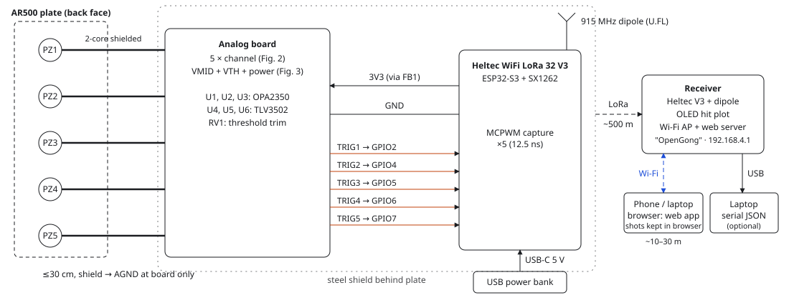
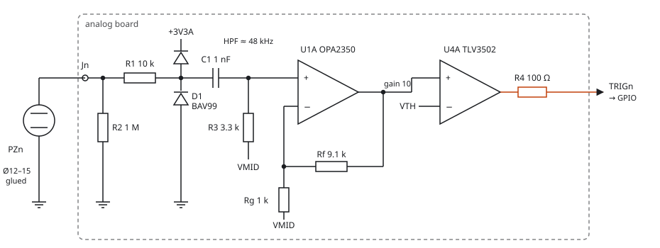
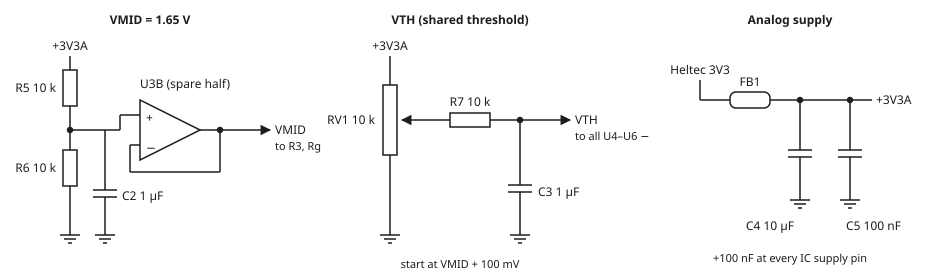

# OpenGong — Wiring Diagram

5-channel threshold-timing build for the 5 mm design: piezo sensors → analog board → Heltec WiFi LoRa 32 V3 (ESP32-S3) → LoRa → receiver. Part values are starting points; tune gain and threshold on the bench.

## 1. System wiring

Everything except the receiver sits behind the plate under a steel shield. The five TRIG lines go into hardware capture pins.

## 2. One sensor channel (build 5)

| Ref | Value | Connection |
| --- | --- | --- |
| Jn | 2-pin screw terminal (2-core shielded cable) | Signal ← core 1 (piezo ceramic electrode); GND ← core 2 (brass) + shield (board end only) |
| R2 | 1 MΩ | Jn signal → GND (bleed/bias for piezo) |
| R1 | 10 kΩ | Jn signal → node A (series current limit) |
| D1 | BAV99 | Node A clamped to +3V3A (top diode) and GND (bottom diode) |
| C1 | 1 nF | Node A → node B (high-pass) |
| R3 | 3.3 kΩ | Node B → VMID (high-pass ≈ 48 kHz, re-centers signal on VMID) |
| U1A | OPA2350 | + input = node B; − input = Rf/Rg junction |
| Rf | 9.1 kΩ | Op-amp output → − input |
| Rg | 1 kΩ | − input → VMID (gain = 1 + Rf/Rg = 10) |
| U4A | TLV3502 | + input = op-amp output; − input = VTH |
| R4 | 100 Ω | Comparator output → TRIGn → ESP32 capture GPIO |

Signal path: clamp → ~48 kHz high-pass re-centered on VMID → ×10 amplifier → comparator fires when the signal rises past VTH. Channels 2–5 repeat this using the parts in §5. The spare op-amp half buffers VMID (§3).

## 3. Shared bias, threshold and power

| Ref | Value | Connection |
| --- | --- | --- |
| R5 / R6 | 10 kΩ / 10 kΩ | Divider +3V3A → GND; midpoint → U3B + input |
| C2 | 1 µF | Divider midpoint → GND |
| U3B | OPA2350 (spare half) | Voltage follower (− tied to output); output = VMID to all R3 and Rg |
| RV1 | 10 kΩ trim pot | Ends to +3V3A and GND; wiper → R7 |
| R7 | 10 kΩ | Wiper → VTH node |
| C3 | 1 µF | VTH node → GND |
| FB1 | Ferrite bead | Heltec 3V3 → +3V3A analog rail |
| C4 / C5 | 10 µF / 100 nF | +3V3A → GND, plus 100 nF at each IC supply pin |

One VMID and one VTH serve all five channels. Turn RV1 until the comparators stop firing on noise, then add a little margin.

## 4. Heltec V3 connections

| Heltec V3 pin | Connects to | Notes |
| --- | --- | --- |
| `GPIO2` | TRIG1 (U4A out via R4) | MCPWM0 capture 0 |
| `GPIO4` | TRIG2 (U4B) | MCPWM0 capture 1 |
| `GPIO5` | TRIG3 (U5A) | MCPWM0 capture 2 |
| `GPIO6` | TRIG4 (U5B) | MCPWM1 capture 0 |
| `GPIO7` | TRIG5 (U6A) | MCPWM1 capture 1 |
| `GPIO48` | Nothing: leave unconnected | Firmware drives it internally to sync the two MCPWM capture timers |
| `3V3` | FB1 → +3V3A analog rail | Always-on 3.3 V. Don't use `Ve`; it's switched by GPIO36. |
| `GND` | Analog board GND (single point) | Star ground; cable shields tie here only. |
| USB-C | Power bank (5 V) | Bank must supply ≥600 mA without auto-shutoff. |
| LoRa U.FL | 915 MHz dipole | Connect before powering on. |

Pins already used on the board, so leave them alone: `GPIO8–14` (SX1262 radio), `GPIO17/18/21` (OLED), `GPIO0` (button), `GPIO1` (battery ADC), `GPIO35` (LED), `GPIO36` (Vext), `GPIO19/20` (USB), `GPIO43/44` (serial). Avoid strapping pins `GPIO3`, `GPIO45` and `GPIO46`. MCPWM inputs route through the GPIO matrix, so any free pin works if you prefer others.

## 5. Channel-to-part map

| Channel | Sensor | Amplifier | Comparator | ESP32 pin |
| --- | --- | --- | --- | --- |
| 1 | PZ1 / J1 | U1A | U4A | GPIO2 |
| 2 | PZ2 / J2 | U1B | U4B | GPIO4 |
| 3 | PZ3 / J3 | U2A | U5A | GPIO5 |
| 4 | PZ4 / J4 | U2B | U5B | GPIO6 |
| 5 | PZ5 / J5 | U3A | U6A | GPIO7 |
| — | — | U3B → VMID buffer | U6B unused (tie + to GND, − to +3V3A) | — |

## 6. Wiring notes

- **Polarity:** wire every piezo the same way (brass/outer electrode to GND, ceramic/center to the signal). The comparator only detects a rising edge. If the bench scope shows the first arrival goes negative, swap the comparator's + and − inputs on all channels.
- **Cable:** thin 2-core shielded cable with a braided or spiral shield, 24–28 AWG stranded cores, about 3–4.5 mm outside diameter (sold as 2-core shielded microphone or instrument cable). Core 1 goes to the ceramic, core 2 to the brass, and the shield is left unconnected at the sensor end. Avoid thick industrial CAN/DeviceNet cable: it is stiff enough to stress the sensor joint, and foil shields crack under constant vibration. Plain coax doesn't suit this scheme because its shield would have to carry the brass return. Cut all five cables to the same length, fix each one to the plate or cover a few cm from its sensor, and leave a small slack loop to the disc.
- **Grounding:** run each cable shield to AGND at its connector only, never at the sensor end. Keep the analog board within 30 cm of the sensors and the Heltec within a few cm of the board.
- **Gain and threshold:** if near-impact sensors saturate early and far ones barely trigger, lower gain (Rf 4.7 k = gain 5.7) and lower VTH together.
- **Optional peak detectors:** to add walk correction later, tap each amplifier output into a diode + 10 nF + 1 M peak hold and read it on a free ADC1 pin.
- **Before first power-up:** antenna attached, no shorts between 3V3 and GND, and VTH measured with a meter.

## 7. Printed circuit board

[`hardware/analog-board`](../hardware/analog-board/README.md) is a ready-to-order 2-layer PCB of this circuit, with gerbers, BOM, assembly steps and the KiCad project. The Heltec V3 plugs straight into it. Because one board carries five copies of each channel part, the board numbers them per channel:

| This document | On the PCB (channel *n*) |
| --- | --- |
| Jn, D1 | Jn (screw terminal), Dn |
| R1, R2, R3, R4 | Rn1, Rn2, Rn3, Rn4 |
| Rf, Rg, C1 | Rn5, Rn6, Cn1 |
| R5 / R6, C2 (VMID) | R1 / R2, C1 |
| RV1, R7, C3 (VTH) | RV1, R3, C2 |
| FB1, C4 / C5 (supply) | FB1, C3 / C4 |
| 100 nF per IC | C101–C106 (U1–U6) |
| U1–U6 | U1–U6 |

On the PCB, the comparator inputs can't be swapped without cutting tracks. Don't swap the wires at the terminals either; that would put the cable shield on the signal input. If the first arrival goes negative (see Polarity above):
1. Set VTH a little **below** VMID. The comparator outputs then sit high and fall when the signal dips past VTH.
2. In `firmware/src/target/capture.cpp`, set `pos_edge = false` and `neg_edge = true` so the capture catches that falling edge.

> **Safety:** all of this hardware, including cables, must sit fully behind the plate under the steel shield. Bullet splash sprays along the plate face.
