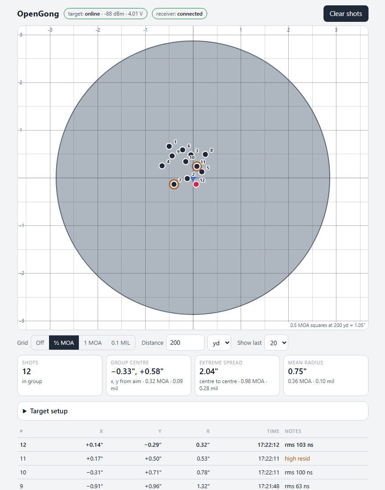
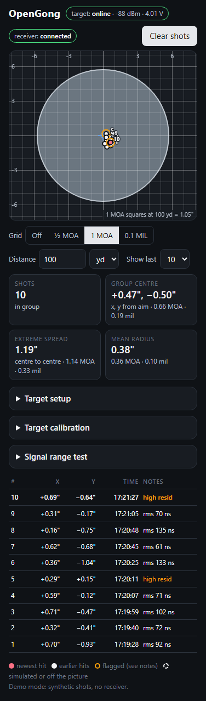
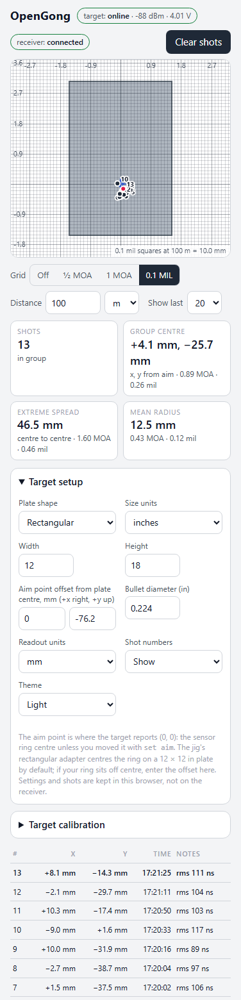
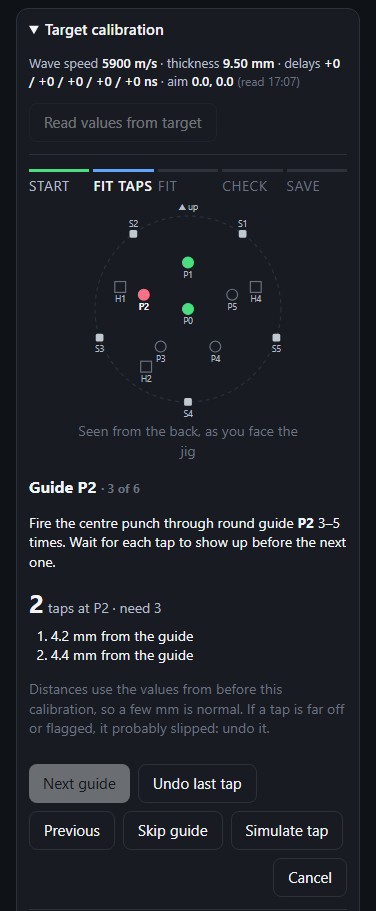
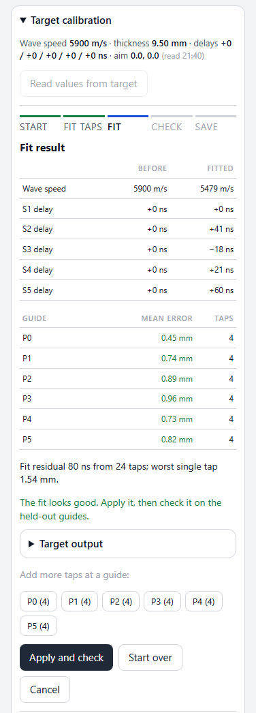
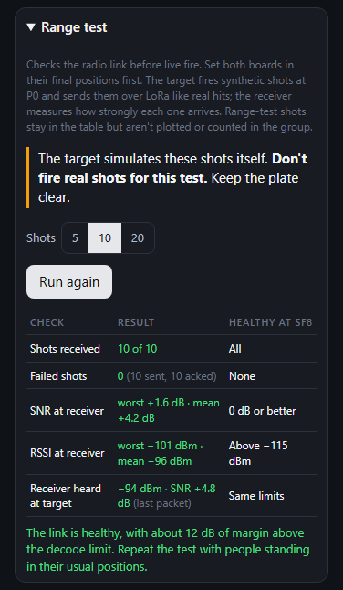

# OpenGong firmware

Firmware for the two Heltec WiFi LoRa 32 V3 boards in [the system design](../docs/System-Design.md):

- **target**: behind the plate. It timestamps the five comparator TRIG lines in hardware, solves the impact position and sends it over LoRa.
- **receiver**: at the firing line. It acknowledges shots, shows the hit and group on its OLED, runs a Wi-Fi network with a [web app](#web-app) for your phone or laptop, and prints JSON over USB.

## Build and flash

Install [PlatformIO](https://platformio.org/install) (the VS Code extension or `pip install platformio`), then from this folder:

```
pio run -e target   -t upload     # plug in the target board
pio run -e receiver -t upload     # plug in the receiver board
pio device monitor                # 115200 baud
```

The project uses Arduino-ESP32 3.x (ESP-IDF 5) through the pioarduino platform, because the capture code needs the IDF 5 MCPWM capture driver. RadioLib and the ThingPulse SSD1306 library are fetched automatically.

**Before powering either board, attach its antenna.** The default band is 915 MHz (US) at +17 dBm. For the EU, change `-DOG_BAND=915` to `-DOG_BAND=868` in [platformio.ini](platformio.ini). That sets 868.1 MHz and +14 dBm (the 25 mW ERP limit) together on both boards, and the build refuses a higher power. To change the power yourself, add `-DOG_LORA_POWER_DBM=n` next to it. Both boards print their frequency and power in the boot line on USB. If two OpenGong systems share a range, give each one its own `-DOG_NET_ID` in [platformio.ini](platformio.ini), and its own Wi-Fi name with `OG_WIFI_SSID` (the password is `OG_WIFI_PASS`, both in the receiver section of the same file).

## Layout

| Path | What it does |
| --- | --- |
| [lib/OpenGongProto/](lib/OpenGongProto/) | Board pins, LoRa settings, packet format, CRC (shared by both boards) |
| [lib/OpenGongSolver/](lib/OpenGongSolver/) | Levenberg–Marquardt position solver and calibration fit (plain C++) |
| [src/target/capture.cpp](src/target/capture.cpp) | MCPWM hardware capture, window, hold-off, re-arm |
| [src/target/processor.cpp](src/target/processor.cpp) | Raw times → solved shot, flags, calibration taps, JSON output |
| [src/target/link.cpp](src/target/link.cpp) | LoRa task: shot + ACK + 3 retries, status heartbeat, remote commands |
| [src/target/console.cpp](src/target/console.cpp) | Text commands over USB serial or relayed over LoRa |
| [src/target/config.cpp](src/target/config.cpp) | Settings stored in flash (NVS) |
| [src/receiver/main.cpp](src/receiver/main.cpp) | Receiver: ACK, de-duplication, group stats, OLED plot, command relay |
| [src/receiver/webui.cpp](src/receiver/webui.cpp) | Receiver: Wi-Fi access point, DNS, HTTP API, RAM shot buffer |
| [src/receiver/web/index.html](src/receiver/web/index.html) | The web app. Open it in a browser with `?demo` to try it without hardware |
| [tools/embed_web.py](tools/embed_web.py) | Pre-build step: gzips the web app into `src/receiver/web_page.h` |
| [test/host/solver_sim.cpp](test/host/solver_sim.cpp) | PC test of the solver and calibration (see below) |

## How the target works

1. **Capture.** Channels 1–3 run on MCPWM group 0 and channels 4–5 on group 1, with pins as in the [wiring diagram](../docs/Wiring-Diagram.md#4-heltec-v3-connections): GPIO 2, 4, 5, 6 and 7. The first rising edge on each channel latches the 80 MHz capture timer in hardware, so each timestamp has 12.5 ns resolution with no software delay.
2. **Timer sync.** Each MCPWM group has its own capture timer. Before every arm, the firmware toggles **GPIO48** internally, and that one edge resets both timers to zero at the same instant. **Leave GPIO48 unconnected.**
3. **Window.** The first edge opens a 200 µs window. When it closes, captures are switched off for the 250 ms hold-off, so the ringing plate doesn't flood the CPU with interrupts. If fewer than `minch` channels (default 4) fired, the event is logged as a reject and the target re-arms after 20 ms.
4. **Solve.** The solver removes each channel's calibrated delay, then fits x, y and the impact time with Levenberg–Marquardt from three starting points. The model includes plate thickness. If the RMS residual is above `rlim` and at least 5 channels fired, it re-solves without each channel in turn. It keeps a result only if the residual is clearly better, and flags it `dropped_ch`.
5. **Report.** Each shot is printed as a JSON line on USB, shown on the OLED and queued for LoRa. The radio runs in its own task on core 0, so sending and retries never delay capture.

## Coordinates

All coordinates use the jig's **front-view frame** ([System-Design 4.1](../docs/System-Design.md#41-placement-jig-petg-model-opengong_jigscad)): millimetres from the **ring centre**, +y up as the plate hangs, and x as the shooter sees it. The jig model is drawn from the back, so x_front = −x_model; use the front-view values the OpenSCAD file prints. That frame covers sensor positions, the aim point, calibration points and `sim`.

Shot results are reported relative to the aim point, which defaults to the ring centre (0, 0). `flip` is off by default. Use `set flip` only if hits show up mirrored.

Each shot's JSON also includes `px`/`py`, the raw position before the aim offset is applied.

Wherever a command takes a point (`cal at`, `check` and `sim`), you can type the name of a jig punch guide instead of coordinates: `P0`–`P5` (fitting) or `H1`, `H2` and `H4` (held out). These match System-Design 8, step 2.

## First boot and bring-up

1. Flash the target, open the serial monitor and run `show`. The defaults are the 120 mm jig ring from System-Design 8 (S1–S5 = channels 1–5, S4 straight down), 5900 m/s and 9.5 mm thickness. If your jig or plate differs, set the sensor positions and thickness, then save:
   ```
   set s 1 -70.53 97.08
   set h 9.5
   save
   ```
2. **Check the solver and radio without hardware.** Flash the receiver too, then on the target run `sim P1 150`. That's a synthetic hit at punch guide P1 (0, 60) with 150 ns noise. The target and receiver should both report about x 0, y +60, flagged `sim`.
3. **Check timer sync on the bench.** Drive all five TRIG inputs from one signal, either a 3.3 V function generator or a single comparator output, and pulse it. Every shot should show `t_ns` within about ±25 ns on all channels. If channels 4–5 are offset from 1–3, the group sync isn't working.
4. **Check the threshold.** Run `stats`; it shows per-channel edge counts while armed. With the plate quiet, the counts should stay still. If they climb, raise VTH with RV1.
5. **Check the sensors.** Tap with the center punch. All channels should fire (`"fired":"12345"`), and for repeated taps at one spot, `t_ns` should repeat within about 200 ns.

## Calibration

The fit runs on the target itself, so no laptop is needed. With known tap positions, the arrival-time model is linear in 1/v, the channel delays and each tap's start time. It's solved directly, not iteratively.

With the jig seated on the back face:

```
cal start                 # back-face taps (thickness set to 0 for the fit); "cal start front" otherwise
cal at P0                 #   ...tap 3-5 times through guide P0...
cal at P1                 #   ...tap 3-5 times... and so on through P5
cal list                  # taps per point
cal undo                  # drop the last tap if it was a bad one
cal fit                   # fits wave speed + delays; prints per-point error with the new values
cal apply                 # copy the result into the live config
cal stop
check H1                  # tap held-out guide H1 3-5 times: judge err_mean_mm (aim for < 2 mm);
                          #   single taps can exceed 2 mm from timing jitter alone
check H2
check H4
check off
save
```

While `check` is on, shots are solved for the same face as the last `cal start` (back by default). Turn it off with `check off` before live fire, so shots are solved with the full plate thickness.

Recalibrate for each plate. Calibration and settings are stored on the target board, one set per board.

Saved settings survive firmware updates. Each setting is stored separately, so a newer firmware keeps every value it still uses, and a setting it adds starts at its default. The first boot after updating from older firmware converts the old saved settings and prints `config: converted settings from older firmware; calibration kept`.

If the target ever runs without saved settings, it says so instead of quietly using the defaults. That happens on a new board, after `defaults`, or if the saved values can't be used. The boot message and `show` print a warning, the target's OLED shows `NOT CALIBRATED - save`, the receiver's OLED shows `NOCAL`, and the web app flags the target as not calibrated. The warning clears when you `save`.

Before you update the firmware, run `export` and keep its output. It prints every setting as a `set` command. If you ever need the values back, paste those lines into the console, then `save`.

- `cal fit fixv` fits only the delays and keeps the current wave speed.
- Channel 1's delay is the zero reference, so other channels' delays can be negative.
- A fitted speed far outside about 2500–7000 m/s means the sensor coordinates or tap positions are wrong.

You can run all of this from the firing line too:

- **From a phone:** open the web app's **Target calibration** panel and press **Start guided calibration** ([Web app](#web-app)). It sends the same commands for you.
- **From a laptop:** type the same commands into the receiver's serial monitor, and they're relayed to the target over LoRa.

## Commands

Commands are typed into the target's serial monitor, or into the receiver's (which relays them over LoRa).

| Command | Effect |
| --- | --- |
| `help`, `show`, `stats` | Command list, current configuration, trigger and link counters |
| `set s <ch> <x> <y>` | Sensor position, mm |
| `set d <ch> <ns>` | Channel delay (normally set by `cal apply`) |
| `set v <m/s>` / `set h <mm>` | Wave speed / plate thickness |
| `set aim <x> <y>` / `set flip <fx> <fy>` | Reported origin / axis mirroring |
| `set n <4-5>` / `set minch <n>` | Sensor count (needs `save` + `reboot`) / channels needed per shot |
| `set win <us>` / `set hold <ms>` / `set rlim <ns>` | Capture window (20–5000 µs) / hold-off (0–5000 ms) / residual flag limit (50–10000 ns) |
| `save`, `load`, `defaults`, `reboot` | Flash storage. Changes are live right away but are lost on reboot unless saved. `load` goes back to the saved settings; if nothing is saved, it leaves the live settings alone |
| `export` | Print every setting as a `set` command, as a backup you can paste back |
| `sim <pt> [noise_ns]` | Inject a synthetic hit (`<pt>` = `<x> <y>` or a guide name such as `P2`) |
| `check <pt>` / `check off` | Report each shot's error from a known point |
| `cal ...` | See [Calibration](#calibration) |

Receiver-only commands: `rx clear` (start a new group, on the OLED and in every connected browser), `rx stats` and `rx help`.

## Web app

The receiver runs its own Wi-Fi network, so no laptop, cable or internet is needed at the firing line.


1. On your phone or laptop, join the Wi-Fi network **OpenGong** (password `opengong`). The name and address are also shown on the receiver's OLED until the first shot arrives.
2. Open **http://192.168.4.1/** (or `http://opengong.local/`). Any address you type while on that network lands on the app.
3. Open **Target setup** once and enter your plate: round or rectangular, its size in inches or mm, and your bullet diameter. If the sensor ring isn't centred on the plate, enter the aim point's offset from the plate centre. The target's reported (0, 0) is the sensor ring centre unless you changed it with `set aim`.
4. Set the **distance** to the target and pick a **grid**: off, ½ MOA, 1 MOA or 0.1 MIL. Squares are drawn at the true size for that distance (1 MOA at 100 yd = 1.047 in; 0.1 mil at 100 m = 10 mm), centred on the aim point.

What you get:

- The plate drawn to scale, each hit as a bullet-sized hole numbered in order, the newest in red. Flagged shots (`high_resid`, `missing_ch`, `dropped_ch`, `outside_ring`) get an amber ring and a note; `sim` shots are dashed; `cal` taps and `no_fix` shots are listed but not plotted.
- Group centre, extreme spread and mean radius for the shots on screen, in inches or mm and in MOA and mil.
- **Show last** 10, 20, 50 or all shots. Tap a hit or a table row to highlight it.
- **Clear shots** starts a new group everywhere: this browser, the receiver's OLED and every other connected browser.
- **Target calibration** reads the target's calibration values and walks you through calibrating from your phone, with the jig on the plate:
  1. Tap each round guide P0–P5 3–5 times. A diagram of the jig, seen from the back, shows which guide is next, and each tap appears as it's recorded. **Undo last tap** removes a slip.
  2. The target fits the wave speed and channel delays. The page shows the fitted values next to the old ones, plus each guide's error.
  3. Apply the fit, then tap each square guide H1, H2 and H4 to check it. Aim for a mean error under 2 mm.
  4. Save the values on the target, or discard them to go back to the saved ones.

  **Edit values by hand** sets the wave speed, plate thickness, aim point, channel delays and sensor positions directly, then saves them on the target. Check taps are listed as `cal check` and kept out of the group. The wizard uses the default jig's guide names, so a modified jig still needs the serial console.

<details>
<summary>Screenshot: the web app on a laptop</summary>



</details>

<details>
<summary>Screenshots: phone views of a round and a rectangular plate</summary>

<p>


</p>

*Left: a round plate at 100 yd with a 1 MOA grid, dark theme. Right: a 12 × 18 in rectangular plate at 100 m with a 0.1 mil grid and the ring 3 in below the plate centre, with Target setup open. Both were captured in demo mode, so the shots are synthetic.*

</details>

<details>
<summary>Screenshots: calibrating from a phone</summary>

<p>


</p>

*Calibration from a phone. Left: tapping guide P2, with the jig drawn as you see it from behind the plate. Right: the fit result before it's applied and checked. Both were captured in demo mode against a simulated target.*

</details>

**Signal range test.** The **Signal range test** panel runs the pre-fire link check from [System Design §9.6](../docs/System-Design.md#96-signal-range-test). It sends `sim P0` to the target 5, 10 or 20 times and collects each synthetic shot's RSSI and SNR at the receiver. It also reads `stats` before and after, for the target's sent, acked and failed counts and the signal it last heard from the receiver. It then marks each result against the healthy-link limits for SF8. Signal range test shots are listed in the table as "sim, signal range test" but aren't plotted or counted in the group. Tap any plotted hit to see its RSSI and SNR.

<details>
<summary>Screenshot: the signal range test result</summary>

<p>

</p>

*The signal range test after 10 shots, captured in demo mode against a simulated target.*

</details>

**Where the shots live.** The browser is the store of record: shots (up to 500) and your settings are kept in that browser's local storage, so they survive reloads and receiver reboots, and nothing is written to the receiver's flash. The receiver only keeps the last 64 shots in RAM so a page that was closed or asleep can catch up when it reconnects. If a phone is off the network for more than 64 shots, the earlier ones are missing from that phone. Each phone or laptop has its own history and its own settings. Clearing the browser's site data clears the shots.

**Network notes.** Up to 4 devices can connect. Wi-Fi range from the Heltec's small PCB antenna is roughly 10–30 m, so keep the receiver on the bench. The receiver answers the operating system's "is the internet reachable" checks so that phones stay on the network without nagging; while connected, other apps on that device have no internet. Wi-Fi adds about 100 mA to the receiver's draw, so budget for it on battery. The Heltec's Wi-Fi and LoRa radios are independent, so the web app doesn't affect shot reception.

**API.** The app polls `GET /api/shots?since=<seq>` twice a second. The reply has the receiver's boot id and sequence counter, a clear counter, the target's last-heard status and the buffered shots newer than `seq`, each with the same fields as the serial JSON plus `seq` and `t_ms`. `POST /api/clear` empties the buffer and bumps the clear counter. Shot keys are (`boot`, `n`), the same as the serial de-duplication. Anything else that reads the receiver can use the same two calls.

`POST /api/cmd` with the form field `c=<command>` relays one console command to the target and returns `{ok, id}`. Poll `GET /api/cmd?id=<id>` until `state` is `done`; `text` then holds the target's reply, exactly as the serial console prints it. If `gap` is true, a chunk of the reply was lost. The receiver keeps the last 4 commands. Commands over LoRa aren't acknowledged, so if no reply arrives within a few seconds, the command may or may not have run. Resend only commands that are safe to repeat; the calibration wizard never resends `cal undo`. `rx` commands are serial-only.

**Changing the page.** Edit [src/receiver/web/index.html](src/receiver/web/index.html) and rebuild; [tools/embed_web.py](tools/embed_web.py) gzips it into `src/receiver/web_page.h` (generated, not committed) before each receiver build. To work on the page without a receiver, open the file in a browser with `?demo` on the URL: it then invents shots, and a simulated target answers the calibration and signal range test panels, with a **Simulate tap** button.

## Serial output

Lines starting with `{` are JSON events; all other lines are for people to read.

Target:
```json
{"type":"shot","n":12,"x":-3.4,"y":21.7,"px":155.8,"py":174.1,"rms_ns":96,"fired":"12345","used":"12345","flags":[],"t_ns":[0.0,18412.5,30125.0,29987.5,17250.0]}
{"type":"reject","fired":"-2---","need":4}
```

Receiver:
```json
{"type":"shot","boot":40211,"n":12,"x":-3.4,"y":21.7,"rms_ns":96,"fired":31,"used":31,"flags":[],"batt_mv":4105,"rssi":-92,"snr":7.5,"group":{"n":5,"mpi_x":-1.2,"mpi_y":18.0,"es_mm":31.4}}
{"type":"status","boot":40211,"shots":12,"rejects":1,"batt_mv":4105,"uptime_min":14,"n_ch":5,"mode":"normal","rssi":-91}
```

Flags:

| Flag | Meaning |
| --- | --- |
| `missing_ch` | Not every channel fired; the shot was solved with the rest |
| `high_resid` | Residual above `rlim`; likely a bad trigger, so treat the position as suspect |
| `dropped_ch` | The solver discarded one bad channel |
| `outside_ring` | Hit is outside the sensor ring, so accuracy is reduced |
| `no_fix` | The solver failed |
| `cal` | Calibration tap |
| `sim` | Synthetic shot from `sim` |
| `check` | Taken while `check` is on; left out of the group |

`batt_mv` reads the Heltec battery divider, so it only means something with a LiPo connected to the board's battery connector. On a USB power bank, ignore it. If your board is a V3.2, set `kVbatCtrlOn` to `HIGH` in [board.h](src/target/board.h).

## Radio link

- **Settings:** SF8 / 125 kHz / CR 4/5 / sync word 0x12, set in [OpenGongProto.h](lib/OpenGongProto/OpenGongProto.h). Frequency and power come from `OG_BAND` in [platformio.ini](platformio.ini): 915 MHz at +17 dBm (US) or 868.1 MHz at +14 dBm (EU).
- **Shot packets:** 20 bytes, about 103 ms on air (ACK: 9 bytes, about 72 ms). The receiver ACKs every copy it gets, from a dedicated radio task, so the ACK goes out within a few ms even while the receiver is serving the web app or redrawing the OLED. If no ACK arrives, the target resends up to 3 times with a random back-off, and it keeps listening through the back-off so a late ACK still counts. Each target boot picks a random `boot` ID, and the receiver de-duplicates on (`boot`, `n`).
- **Status:** the target sends a status packet every 30 s.
- **Command responses:** sent back in 200-byte chunks.
- **Command retries:** commands aren't acknowledged. If no reply arrives, the web app resends the same command up to twice, with the same sequence number. The target remembers the last command it ran, and for 60 s it answers a repeat of that command with the saved reply instead of running it again, so a retried `cal at` or `cal undo` can't add or remove an extra tap. A line you retype into the receiver's serial monitor is a new command and runs again.

## Host test

The solver has no hardware dependencies. [solver_sim.cpp](test/host/solver_sim.cpp) checks it in three ways:

- It reproduces the accuracy table from System-Design section 2.
- It runs a simulated calibration with unknown speed and delays.
- It checks bad-trigger rejection.

```
g++ -O2 -std=c++17 -I lib/OpenGongSolver test/host/solver_sim.cpp lib/OpenGongSolver/Solver.cpp -o solver_sim && ./solver_sim
```

Current result: 200 ns timing scatter gives a 1.1 mm mean and 2.2 mm 95th-percentile error. Calibration recovers the wave speed to within 0.1%. Without calibration, a 4% speed error plus channel delays costs up to 9 mm.

## Known limits

- **Capture overwrite:** the capture register is read in the interrupt handler. If a comparator chatters with edges less than a few µs apart, a later edge could overwrite the first before it's read. The comparator's hysteresis and the 50 kHz high-pass should prevent this; check on the scope during bring-up.
- **Not implemented:** peak-detector walk correction (System-Design section 5, optional). It's a natural next step if the punch test shows it's needed. Bluetooth on the receiver isn't planned now that the web app covers phones.
- **Web app history is per browser.** The receiver buffers only the last 64 shots in RAM, so a device that was off the network longer than that misses the earlier shots. An SD card or the receiver's flash would fix that, but neither is used by design.
