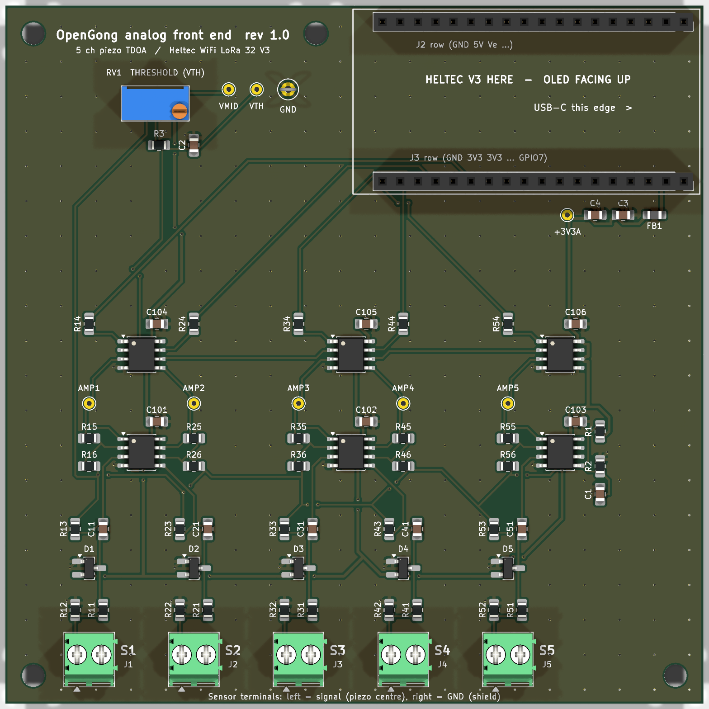

# OpenGong analog front-end board

The one custom circuit board in OpenGong. It carries the five sensor channels from [Wiring Diagram](../../docs/Wiring-Diagram.md). The target's Heltec WiFi LoRa 32 V3 plugs straight into it on two header sockets. The receiver is a stock Heltec V3 and needs no custom board.



| | |
| --- | --- |
| Size | 100 × 100 mm, 2 layers, 1.6 mm FR-4, 1 oz copper |
| Smallest feature | 0.25 mm track, 0.2 mm clearance, 0.3 mm drill (any budget fab can make it) |
| Parts | Hand-solderable: 0805 passives, SOIC-8 ICs, SOT-23 diodes, through-hole connectors and trimmer |
| Checks | KiCad 10 DRC with 0 errors and 0 unconnected items, schematic-to-board parity clean, ERC 0 errors |

## Files

| File | What it's for |
| --- | --- |
| [`fab/opengong-analog-gerbers.zip`](fab/opengong-analog-gerbers.zip) | **Upload this to the board house.** Gerbers (copper, mask, silkscreen, paste, outline) plus Excellon drill files. |
| [`fab/opengong-analog-bom.csv`](fab/opengong-analog-bom.csv) | Bill of materials, grouped by value, with suggested part numbers. |
| [`docs/opengong-analog-schematic.pdf`](docs/opengong-analog-schematic.pdf) | Schematic. |
| [`docs/opengong-analog-assembly.pdf`](docs/opengong-analog-assembly.pdf) | Assembly drawing: part outlines and reference designators, for finding where each part goes. |
| `opengong-analog.kicad_pro / .kicad_sch / .kicad_pcb` | The KiCad 10 project, if you want to change the board. |
| [`tools/`](tools/) | Scripts that generate the schematic and board and export everything. |

## 1. Order the bare boards

1. Go to any PCB service (JLCPCB, PCBWay, OSH Park, Aisler and so on) and upload `fab/opengong-analog-gerbers.zip`. The site reads the size (100 × 100 mm) and layer count (2) from the files.
2. Keep the default options: 1.6 mm thickness, 1 oz copper, HASL or ENIG finish, any solder-mask colour. Order the minimum quantity (usually 5). Spares are handy.
3. Don't order a stencil or assembly; you'll solder the parts yourself.

At the larger budget fabs, 100 × 100 mm is the largest size in the cheapest price tier.

> **Check the Heltec row spacing before you order.** Heltec's V3 datasheet gives the module as 50.2 × 25.5 mm with two 18-pin rows at 2.54 mm pitch, but doesn't print the distance between the two rows. This board uses **22.86 mm (0.9 in) centre to centre**, which puts both rows 1.32 mm in from the module edges. Measure your module with calipers; if it differs, see [Changing the board](#6-changing-the-board).

## 2. Get the parts

[`fab/opengong-analog-bom.csv`](fab/opengong-analog-bom.csv) is the full list. In summary:

| Qty | Part | Notes |
| --- | --- | --- |
| 3 | OPA2350UA, SOIC-8 | U1–U3 |
| 3 | TLV3502AID, SOIC-8 | U4–U6. Must be a push-pull part; an LMV393 (open-drain) would need pull-ups the board doesn't have. |
| 5 | BAV99, SOT-23 | D1–D5 |
| 5 | Phoenix PT 1,5/2-3,5-H (1984617), 3.5 mm 2-way screw terminal | J1–J5, one per sensor |
| 2 | 1×18 female header, 2.54 mm, 8.5 mm tall | J7, J8 for the Heltec |
| 1 | Bourns 3296W 10 k multi-turn trimmer | RV1, threshold |
| 1 | 0805 ferrite bead, ~220 Ω at 100 MHz | FB1 |
| — | 0805 resistors, 1 % | 10k ×8, 1M ×5, 3.3k ×5, 9.1k ×5, 1k ×5, 100 Ω ×5 |
| — | 0805 capacitors | 1 nF **C0G/NP0** ×5, 100 nF ×7, 1 µF ×2, 10 µF ×1 |

The test points (TP1–TP9) are bare pads. Clip a scope probe to a short loop of resistor-lead offcut soldered into each one.

## 3. Assemble

Use a fine-tip iron, flux and 0.5 mm solder. Fit low parts first so the board sits flat while you work:

1. **ICs** (U1–U6): check that the pin-1 dot matches the silkscreen mark. Tack one corner pin, check alignment, then solder the rest. U1–U3 are OPA2350 (op-amps, lower row); U4–U6 are TLV3502 (comparators, upper row).
2. **BAV99 diodes** (D1–D5): the single pad (pin 3) faces right.
3. **0805 resistors and capacitors.** Reference designators follow the channel: for channel *n*, `Rn1` 10k, `Rn2` 1M, `Rn3` 3.3k, `Rn4` 100 Ω, `Rn5` 9.1k (Rf), `Rn6` 1k (Rg), `Cn1` 1 nF. For example, R35 is channel 3's Rf. The shared parts are R1/R2/C1 (VMID divider), R3/C2 (threshold filter), FB1/C3/C4 (analog supply) and C101–C106 (one 100 nF per IC). The spare comparator half, U6B, is tied off on the board and needs nothing fitted.
4. **Through-hole parts:** RV1, the screw terminals (wire openings toward the board edge), then the two 18-pin sockets. To keep the sockets straight, plug them onto the Heltec's pins, set the module in place, and solder the sockets with the Heltec fitted.
5. Solder the Heltec's own pin headers **pointing down, away from the OLED**, if they aren't already fitted.

## 4. Bring-up

Do this **before** plugging in the Heltec:

1. With a meter, check that +3V3A (TP8) to GND (TP9) isn't a short.
2. Plug in the Heltec (OLED up, USB-C at the board edge), attach the LoRa antenna, and power it over USB.
3. Measure TP8 ≈ 3.3 V, TP6 (VMID) ≈ 1.65 V, and TP7 (VTH). Turn RV1 until VTH sits a little above VMID: the comparators fire when an amplifier output rises past VTH, and the amplifier rests at VMID.
4. Follow the firmware [bring-up and calibration steps](../../firmware/README.md). Raise VTH until the comparators stop firing on noise, then add a little margin ([Wiring Diagram §3](../../docs/Wiring-Diagram.md#3-shared-bias-threshold-and-power)).
5. TP1–TP5 (AMP1–AMP5) are the amplifier outputs, the best place to watch each sensor with a scope.

Wiring the sensors: each terminal's **left** screw is the signal (piezo ceramic/centre electrode) and the **right** screw is GND (cable shield and brass). Tie each shield at the board end only.

## 5. Design notes

- The bottom layer is an almost unbroken ground plane, with a few short crossover links. The top layer carries the signals plus a second ground pour stitched to the bottom one. Every SMD ground pad has its own via.
- Signal flows up each column, from the terminal at the bottom edge to the Heltec at the top, so the noisy digital module stays at the opposite end from the sensor inputs.
- Channel-to-part and pin map are as in [Wiring Diagram §4–5](../../docs/Wiring-Diagram.md#4-heltec-v3-connections). TRIG1–5 go to GPIO2, 4, 5, 6 and 7 on Heltec header J3 (board J8). Header J2 (board J7) only connects GND and holds the module. 3V3 comes from J3 pins 2–3 through FB1. GPIO48 is left unconnected for the firmware's capture-sync line.
- The board has four M3 mounting holes.

## 6. Changing the board

The schematic and board are generated from [`tools/design.py`](tools/design.py), which holds the parts and netlist. Run everything with KiCad 10's bundled Python:

```sh
"<KiCad 10>/bin/python.exe" -I tools/build.py            # regenerate, re-route, check, export
"<KiCad 10>/bin/python.exe" -I tools/build.py --export   # check and export only (after hand edits in KiCad)
```

`build.py` stops if DRC (with schematic parity) or ERC reports any error. For the build to finish, both checks must be clean.

- **Part values** (gain, filter): edit `design.py` and run a full build, or change the value in KiCad and run `--export`.
- **Heltec row spacing:** change `HELTEC_ROW_SPACING` in [`tools/gen_board.py`](tools/gen_board.py) and run a full build.
- **Hand edits in KiCad:** open `opengong-analog.kicad_pro`, edit, save, then run `build.py --export`. A full `build.py` run regenerates both files from the scripts and overwrites hand edits.

`gen_board.py` places the parts and routes them with a small grid router ([`tools/router.py`](tools/router.py)). KiCad's DRC is the final check on its output.
